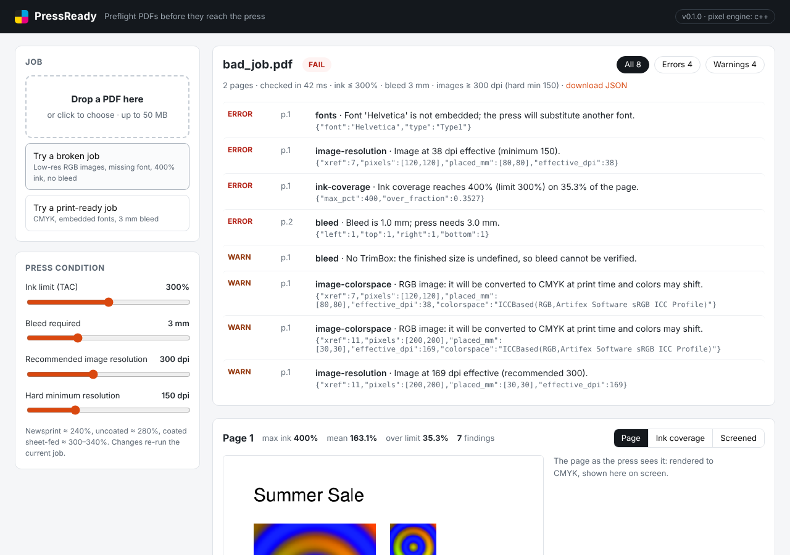

# PressReady

**Preflight print PDFs before they reach the press.** PressReady checks a PDF for the problems that make a print shop hold a job (missing bleed, low-resolution or RGB images, non-embedded fonts, too much ink) and writes a visual report. The pixel analysis runs in a small C++ engine exposed to Python with pybind11.



## What it checks

| Check | What goes wrong on press | How PressReady measures it |
|---|---|---|
| **Bleed** | White slivers at the trimmed edge | Distance from `TrimBox` to `BleedBox` (or `MediaBox`) on all four sides |
| **Image resolution** | Blurry, pixelated photos | *Effective* dpi: pixel size ÷ placed size, taken from the image's transform matrix, so scaled and rotated images are measured correctly |
| **Image color space** | Colors shift when RGB is converted to CMYK at the RIP | Color space of every placed image |
| **Font embedding** | The press substitutes a different font, so text reflows | Every font on every page; Type 3 is skipped because its glyphs are drawn in the PDF itself |
| **Total ink coverage (TAC)** | Ink doesn't dry, sheets set off and stick | Page rendered to a CMYK raster; C++ sums C+M+Y+K per pixel and compares it to the press limit (default 300%) |

Each finding is an **error** (hold the job) or a **warning** (operator should look). Thresholds come from a `Profile`, so a newspaper press (TAC 240%) and a coated sheet-fed press (TAC 300–340%) are both one flag away.

## Quick start

```bash
pip install .                         # builds the C++ extension with CMake + pybind11
python examples/make_samples.py       # writes a clean job and a broken job
pressready examples/bad_job.pdf --html report.html --json report.json
```

```
ERROR p1   fonts             Font 'Helvetica' is not embedded; the press will substitute another font.
ERROR p1   image-resolution  Image at 38 dpi effective (minimum 150).
ERROR p1   ink-coverage      Ink coverage reaches 400% (limit 300%) on 35.3% of the page.
ERROR p2   bleed             Bleed is 1.0 mm; press needs 3.0 mm.
WARN  p1   bleed             No TrimBox: the finished size is undefined, so bleed cannot be verified.
WARN  p1   image-colorspace  RGB image: it will be converted to CMYK at print time and colors may shift.
WARN  p1   image-colorspace  RGB image: it will be converted to CMYK at print time and colors may shift.
WARN  p1   image-resolution  Image at 169 dpi effective (recommended 300).
FAIL: bad_job.pdf — 4 error(s), 4 warning(s) [2 page(s), engine c++]
```

### Web UI

```bash
pip install .[web]
pressready-web                        # open http://127.0.0.1:8000
```

Drop a PDF onto the page, or click **Try a broken job** or **Try a print-ready job**. The UI shows every finding with its measured values. Click a finding to jump to its page, where you can switch between three views: the page, an **ink-coverage heatmap**, and a **screened preview**. The press-condition sliders (ink limit, bleed, resolution) re-run the check as you move them, so you can see how the same file passes on one press and fails on another. The page and its API (`POST /api/preflight`, `GET /api/health`) are served by FastAPI. Uploads are limited to 50 MB and checked for a PDF header.

### Command line

The exit code is `0` pass, `1` warnings, `2` errors, `3` unreadable. A hot folder or CI job can route files on that alone.

```bash
pressready job.pdf --tac-limit 240 --bleed-mm 5 --min-dpi 250   # a different press condition
```

From Python:

```python
from pressready import preflight, Profile
report = preflight("job.pdf", Profile(tac_limit_pct=320))
print(report.status, [i.message for i in report.errors])
```

## How it works

```
PDF ──► PyMuPDF ──┬─► document structure ──► bleed · images · fonts checks ──┐
                  │                                                        ├─► Report ─► terminal · JSON · HTML · web UI
                  └─► CMYK raster (H×W×4) ──► C++ inkcore ──► TAC stats ───┘
                                                   └──► Floyd–Steinberg screening ──► preview
```

* **`cpp/inkcore.cpp`** has two kernels. `tac_analyze` makes one pass over the raster for the per-pixel ink map, max, mean and over-limit count. `halftone_fs` does serpentine Floyd–Steinberg error diffusion per separation, which is the step where a RIP turns continuous tone into printable dots. Both take NumPy arrays without copying and release the GIL.
* **`src/pressready/ink.py`** loads the C++ module and keeps NumPy and pure-Python reference versions of both kernels. The tests check that C++ matches them exactly.
* **`src/pressready/checks.py`** holds the checks, the `Profile` thresholds and the `Report` model.
* **`src/pressready/web.py`** + **`static/index.html`** make up the web UI: a FastAPI backend and one dependency-free page.
* **`src/pressready/report.py`** renders JSON and one self-contained HTML page with three views per page: the page, the ink heatmap, and the screened preview.

### Performance

On a 2-core Xeon @ 2.1 GHz, measured with `python benchmarks/bench_ink.py`:

| Kernel | Input | C++ | Reference | Speed-up |
|---|---|---|---|---|
| TAC analysis | A4 @ 150 dpi, CMYK (1240×1754×4) | 3.3 ms | NumPy 18.2 ms | 5.5× |
| Halftone (4 separations) | A4 @ 150 dpi | 77 ms | — | — |
| Halftone | 256×256×4 | 2.3 ms | Python 122 ms | 53× |

NumPy is already vectorized, so C++ wins on TAC by doing everything in one pass with no temporary arrays. Error diffusion can't be vectorized because each pixel depends on the error from its neighbours, so that's where native code matters most.

## Tests

```bash
pip install .[test] && pytest -q
```

There are 21 tests. They check that the C++ kernels match the references (bit-exact for halftoning), that halftoning preserves tone, and that each check catches its problem in the generated sample jobs, including exact effective-dpi values. They also cover profile thresholds, report rendering, CLI exit codes, and the web API (uploads, samples, settings, rejecting bad input). CI builds the extension and runs everything on Ubuntu and Windows with Python 3.11 and 3.12.

## Limitations

* **Ink coverage depends on the RGB→CMYK conversion.** Native CMYK content is measured as-is. RGB content goes through MuPDF's default conversion, not the press's ICC output profile, so its TAC is an estimate.
* **The screened preview uses error diffusion (FM screening).** Offset presses mostly use AM halftone dots at a screen angle. The preview shows the idea, not the exact dot shape.
* **Not checked yet:** spot colors and separations, overprint, transparency flattening, hairline rules, PDF/X conformance.

## Roadmap

- ICC-managed conversion (LittleCMS) so ink coverage matches a real press profile
- Spot-color and overprint checks
- AM screening at configurable angle and frequency
- Process pages in parallel (the kernels already release the GIL)

## License

MIT
